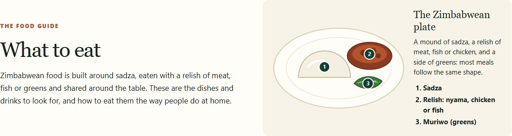
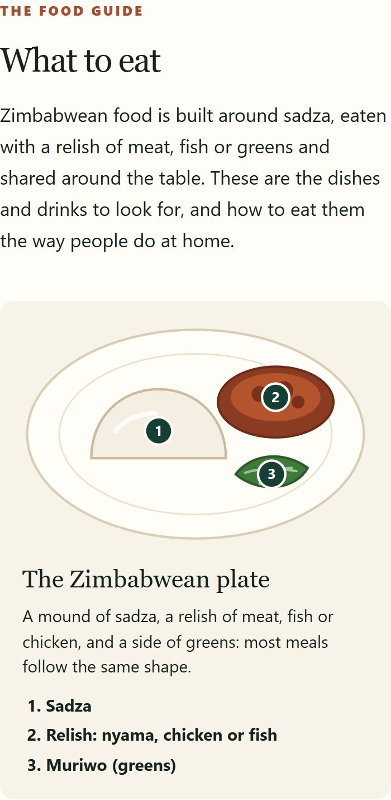
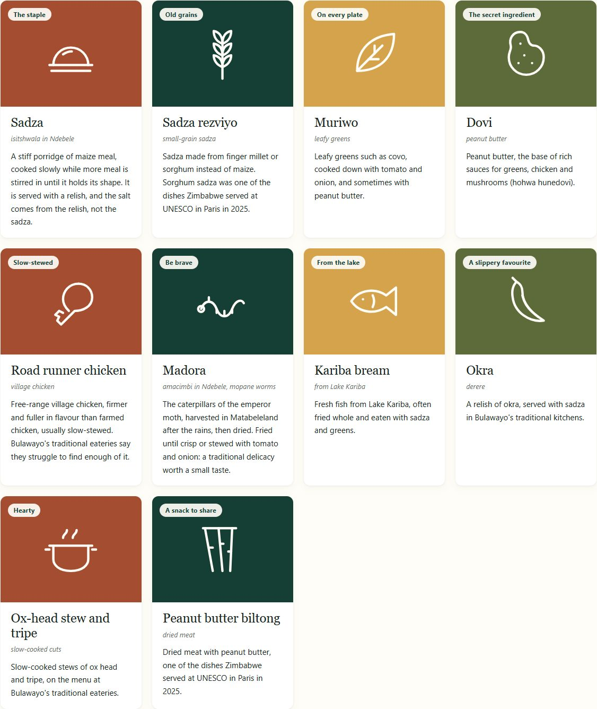
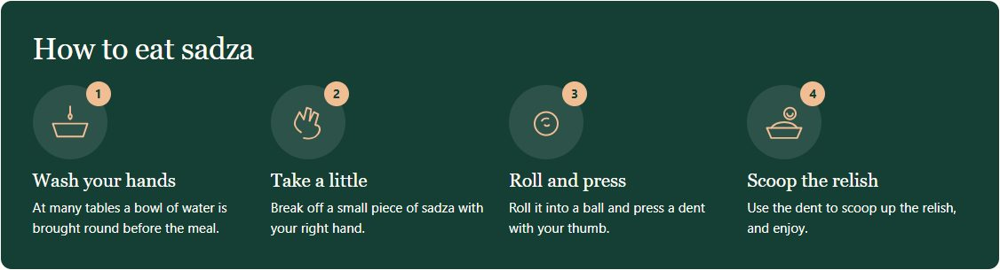
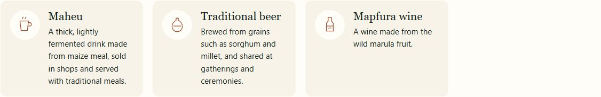
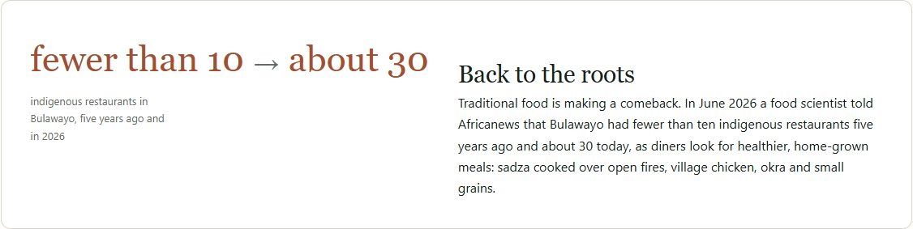

# Visit Zimbabwe: case study

**Building and running an independent national travel guide, solo, from data model to production.**

🌍 **Live:** [govisitzimbabwe.com](https://govisitzimbabwe.com) · 👤 **Built by:** [Kudakwashe Kwindima](https://github.com/Kuda-Kwindima) · 🔒 **Code:** private (this repository explains how it works)



---

## At a glance

| | |
|---|---|
| **What** | A travel guide to Zimbabwe: destinations, places to stay, eat and visit, safaris, itineraries, events and food, in English and French |
| **Role** | Founder and sole engineer: product, data, backend, frontend, infrastructure and operations |
| **Timeline** | First commit 21 September 2026; live on its own domain by November 2026 |
| **Scale** | 347 reviewed places, 9 destinations with 4 sub-areas, about 380 pull requests merged |
| **Stack** | Python 3.12 · FastAPI · Jinja · PostgreSQL/PostGIS · Docker · Fly.io · Cloudflare · GitHub Actions · Playwright |

## The problem

Travel information about Zimbabwe is scattered across old directory listings, social media pages and booking sites that disagree with each other. Phone numbers change, places close, and map pins are often wrong. A guide is only useful if visitors can trust it, so the core problem wasn't the website. It was **deciding what is true and keeping it true.**

## Architecture

```text
 Sources: operators' own websites, official bodies (parks, museums, UNESCO), OpenStreetMap candidates
        │
        ▼
 ┌───────────────────────── Curation (local, PostGIS) ──────────────────────────┐
 │ raw ──► staging ──► core ──────────────► publishing                           │
 │ source   candidates,  places, field-level   explicit approve / hold /         │
 │ records  boundary &   evidence, reviewed    withdraw decisions with a frozen  │
 │          duplicate    map points            reviewed snapshot                 │
 │          screening                                                            │
 └───────────────────────────────────┬──────────────────────────────────────────┘
                                     │ export of approved places only
                                     ▼
                  release/published-places.json (validated on load)
                                     │ baked into the image
                                     ▼
          FastAPI + Jinja on Fly.io (Johannesburg)  ◄── Cloudflare in front
                                     │
                                     ▼
                           govisitzimbabwe.com
```

## Key decisions

### 1. Evidence before publication
Every value shown publicly, such as a name, phone, website or map point, is tied to a recorded source with a date. Publishing is an **explicit decision row**, not a status flag: it stores who decided, under which policy version, the limitations to show visitors, and a frozen snapshot of what was reviewed. Later edits to working data can't silently change a published listing.

```sql
-- From the publication decisions migration (abridged)
CREATE TABLE publishing.place_publication_decisions (
    decision_id        BIGINT GENERATED ALWAYS AS IDENTITY PRIMARY KEY,
    place_id           BIGINT NOT NULL REFERENCES core.places (place_id),
    decision           TEXT   NOT NULL CHECK (decision IN ('approve', 'hold', 'withdraw')),
    policy_version     TEXT   NOT NULL CHECK (btrim(policy_version) <> ''),
    public_limitations TEXT   NOT NULL CHECK (btrim(public_limitations) <> ''),
    reviewed_snapshot  JSONB  NOT NULL CHECK (jsonb_typeof(reviewed_snapshot) = 'object'),
    decided_by         TEXT   NOT NULL DEFAULT current_user,
    decided_at         TIMESTAMPTZ NOT NULL DEFAULT now()
);
```

34 ordered migrations with a checksum ledger build the schema. Database roles separate curation from the read-only listings API.

### 2. No database in production
The public site never connects to the curation database. Approved places are exported to a release file that ships inside the container image. That gives:
- **no production database** to breach, back up, patch or pay for;
- **atomic, reproducible deploys:** the image *is* the content, and a rollback restores both code and data;
- **fast pages** served from memory.

The app refuses to start on a file that isn't a valid release:

```python
@classmethod
def from_file(cls, path: Path):
    data = json.loads(Path(path).read_text(encoding='utf-8'))
    if data.get('schema_version') != 1 or data.get('kind') != 'published_places_release':
        raise RuntimeError(f'{path} is not a published places release')
    places = data.get('places')
    if not isinstance(places, list) or not places or not data.get('built_at'):
        raise RuntimeError(f'{path} has no places or no build time; refusing to serve it')
    ids = [place.get('place_id') for place in places]
    if len(set(ids)) != len(ids) or not all(isinstance(i, int) and i > 0 for i in ids):
        raise RuntimeError(f'{path} has missing or duplicate place ids')
    return cls(places)
```

### 3. Server-rendered and fast on phones
Most visitors are on phones and mobile data. Pages are rendered on the server with Jinja, with small amounts of plain JavaScript for menus, video and My Trip. There's no framework bundle. **My Trip** (saved places and a day planner) lives in the visitor's browser, so there are no accounts and no personal data stored.

### 4. Content as data
Destination stories, category guides, itineraries, events and lists live in versioned JSON and template partials, separate from code. The illustrated food guide's dishes, steps and sources are data. Its artwork is inline SVG, so the page looks finished before photographs exist, and each drawing gets replaced by a credited photo when one arrives.

### 5. Credit and permission for every photo
The photography comes from local creators who gave permission. Media pipelines resize and crop every image (WebP, responsive sizes, header crops only when the source is large enough) and write manifests that record the creator, their link and the licence. Every photo on the site carries its credit and link, and a photo-use audit stops any single image being overused.

```python
def display_credit(credit, url):
    """'© Name' for a credited creator. When the credit links to Instagram, the name is the handle
    unless the creator asked to be named, in which case the link still carries the handle."""
    name = (credit or '').removeprefix('©').strip()
    parts = urlsplit(url or '')
    if (parts.hostname or '').lower().removeprefix('www.') == 'instagram.com':
        handle = parts.path.strip('/').split('/')[0]
        if handle and re.fullmatch(r'[A-Za-z0-9._]{1,30}', handle):
            name = name.removesuffix(' · ' + handle) if name.endswith(' · ' + handle) else handle
    return f'© {name}' if name else ''
```

## Quality and delivery

Every pull request must pass four checks before it can merge:

| Check | What it proves |
|---|---|
| **offline-checks** | Config and Compose files are valid, the code compiles, the public image builds |
| **fast-tests** | About 380 unit, template and data tests: routes, content rules, credits, templates, translations |
| **browser-tests** | Playwright journeys on phone and desktop over **synthetic** data, never real listings; screenshots kept for review |
| **fly-image** | The *exact* production image, built with a synthetic release, started and asked for representative pages |

A **weekly freshness job** flags time-sensitive facts that are past their review date and source links that have broken, so the guide doesn't quietly go stale.

Deploys run from a clean, up-to-date `main` only. The working rules (no direct database changes without approval, no unrelated files in a commit, credits always kept) are written down and enforced in review.

## Screenshots

The best way to see the site is to [visit it](https://govisitzimbabwe.com). Most pages use creators' photographs, which are licensed for the site only, so the screenshots here come from the **illustrated food guide**. Its artwork is inline SVG and its dishes, steps and sources are data, so the page looked finished before any food photography existed.

| Desktop | Phone |
|---|---|
|  |  |






## What I learned

- **Trust is a data-modelling problem.** Evidence tables, explicit decisions and frozen snapshots took longer up front, but they made it safe to grow from 3 listings to 347.
- **The simplest production setup is the most reliable one.** Removing the production database removed a whole class of failures and costs.
- **Tests that build the real production image catch what unit tests miss**, such as missing files, start-up errors and broken routes.
- **Content needs operations too.** Freshness checks, photo audits and credit rules matter as much as code for a guide people rely on.
- **Small, reviewed pull requests** (about 380 in two months) kept a fast-moving solo project stable.

## What's next

- A partner booking engine, so visitors can book through it from a listing
- More areas with interactive maps
- A full French review, and then more languages

---

<sub>The Visit Zimbabwe code and content are private and all rights are reserved.</sub>
